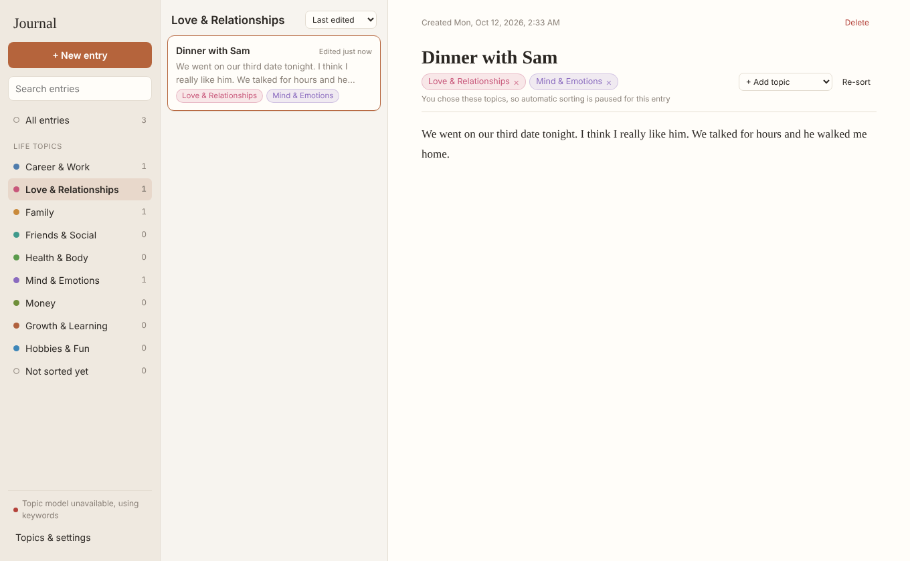

# Journal

A private journal that files each entry under life topics (Career & Work, Love &
Relationships, Family, Health, Money, and more) automatically, using a small
language model that runs on your own computer. Every entry shows when it was
created and when it was last edited.



## Run it

You need [Node.js](https://nodejs.org) 18 or newer.

```bash
cd journal-app
npm install
npm run dev
```

`npm install` also downloads the topic model (about 25 MB) into
`public/models/`, once. From then on it is part of the app: it ships inside the
build and the Electron app, and sorting works fully offline. If that download
is skipped or fails, run `npm run fetch-model` later; until then the app sorts
by keywords.

Then open the address it prints (usually http://localhost:5173).

### As a desktop app (Electron)

```bash
npm run electron
```

This builds the web app and opens it in its own window. Entries live in the
app's own storage, separate from your browser.

## On your phone

The web version is published to GitHub Pages on every push to `main`
(`.github/workflows/pages.yml`):
**https://thelonelymars225.github.io/journal-app/**

Open it once and add it to your home screen:

- **iPhone (Safari):** Share button → **Add to Home Screen**.
- **Android (Chrome):** ⋮ menu → **Add to Home screen** / **Install app**.

After the first visit it works offline, including the topic model. With cloud
sync set up (below), you sign in once per device and entries are saved to
Supabase as well as on the device, so they follow you between phone and
computer. Without it, entries are stored on the device only (use Export /
Import backup to move them). On iPhone, keep using it from the home-screen
icon: Safari can clear data for websites you haven't opened in a while, but
not for apps added to the home screen.

## Cloud sync and sign-in (Supabase)

The journal can be saved to your own [Supabase](https://supabase.com) project,
behind a login that only you have. Topic sorting still runs on the device; only
the entries and your topic settings are stored in Supabase. A copy is kept on
each device, so the app opens instantly and works offline, and changes upload
when you're back online. The first time you sign in on a device, any entries
already on it are uploaded.

One-time setup:

1. Create a project at [supabase.com](https://supabase.com/dashboard).
2. **SQL Editor:** paste [`supabase/schema.sql`](supabase/schema.sql) and run it.
   It creates the tables and the row-level security rules that only let a
   signed-in user see their own rows.
3. **Authentication → Users → Add user:** create your account (email and
   password, with "Auto confirm" on).
4. **Authentication → Sign In / Providers:** turn off **Allow new users to
   sign up**, so nobody else can create an account.
5. **Project Settings → API:** copy the Project URL and the anon (publishable)
   key. In GitHub, add them under **Settings → Secrets and variables → Actions
   → Variables** as `VITE_SUPABASE_URL` and `VITE_SUPABASE_ANON_KEY`, then
   re-run the "Publish web app" workflow.

The anon key is meant to be public; without a login it can't read or write
anything. For local development, put the same two values in a `.env.local`
file. If they're missing, the app builds as local-only with no login.

## Mac app

Every push to `main` builds the Mac app on GitHub (see
`.github/workflows/mac.yml`). To download it, open the repository's
**Actions** tab, pick the latest "Build Mac app" run, and download
**Journal-mac** at the bottom. Inside are two disk images:

- `Journal-<version>-arm64.dmg` for Apple Silicon Macs (M1 and newer)
- `Journal-<version>-x64.dmg` for Intel Macs

Pushing a tag like `v0.1.0` also attaches both to a GitHub Release.

Open the .dmg and drag Journal into Applications. The topic model is already
inside, so it works offline from the first launch.

**First launch (one time only).** The app isn't signed with an Apple developer
certificate yet, so macOS blocks it the first time:

1. Open Journal from Applications. macOS says it can't verify the developer; click **Done**.
2. Open **System Settings → Privacy & Security**, scroll down, and click **Open Anyway** next to the Journal message. Confirm with your password.
   (On macOS 14 or older you can instead right-click Journal in Applications and choose **Open**.)
3. If macOS says the app "is damaged", run this once in Terminal and open it again:
   `xattr -cr /Applications/Journal.app`

After that it opens normally.

To build the .dmg on a Mac yourself: `npm install` then `npm run dist:mac`;
the files land in `release/`.

## How the sorting works

- When you stop typing for about two seconds, the entry is sent to a small
  zero-shot classifier (`Xenova/mobilebert-uncased-mnli`, 8-bit quantized,
  about 25 MB) running in a background worker in the app. It scores how well
  the entry fits each topic's description and files it under the ones that
  clearly fit (up to 3).
- The model and the runtime that executes it (ONNX Runtime WebAssembly, about
  21 MB, 5 MB compressed) are bundled with the app. The app makes no network
  requests at all, so your journal text never leaves your computer.
- Until the model has loaded (or if it isn't bundled), entries are sorted by
  simple keyword matching, and re-sorted by the model once it is ready.
- **New topic suggestions:** in the background the model also checks your
  entries against a pool of extra life topics (Travel, Pets, Faith, Grief &
  Loss, Goals & Plans, and more, in `src/topics.js`). When 3 or more entries
  clearly fit one that isn't in your list, a card in the sidebar offers it.
  "Add topic" adds it and files those entries under it; "Not now" hides that
  suggestion. You can turn suggestions off in settings.
- Add or remove a topic on an entry yourself and automatic sorting stops for
  that entry. "Re-sort" hands it back to the model.
- Topics are editable under **Topics & settings**: rename them, change what
  they cover, add new ones, or delete them. "Re-sort all entries" applies the
  change to everything you've written. The sensitivity slider controls how
  readily an entry gets filed under more than one topic.

## Your data

- **Mac app:** entries are saved as a plain file,
  `~/Library/Application Support/Journal/journal.json`, written the moment you
  type (with the previous version kept as `journal.json.bak`). It survives
  quitting, restarts, and installing a new version. Deleting the app doesn't
  delete it. Settings → "Show journal file" opens it in Finder.
- **Browser / phone:** entries are stored in the browser's own database on that
  device (IndexedDB). Nothing is sent to any server. The app asks the browser
  to protect that data from being cleared (`navigator.storage.persist()`), and
  Settings shows whether it agreed.
- **Backups:** Settings → "Back up to a file" saves everything as one JSON file.
  On iPhone it opens the share sheet, so you can **Save to Files** (iCloud
  Drive or On My iPhone). If you've written something new and haven't backed
  up for 7 days, a reminder appears in the sidebar. "Restore from a backup"
  brings a file back in, skipping entries you already have.

Nothing syncs between devices. Use **Export backup** in settings to save a
JSON copy, and **Import backup** to restore or move it.

## Files

- `src/main.js` — the interface: sidebar, entry list, editor, settings
- `src/db.js` — storage: a JSON file in the Mac app, IndexedDB in a browser
- `electron/preload.cjs` — the narrow bridge the page uses to read/write that file
- `src/topics.js` — default topics and the keyword fallback
- `src/classifier.js`, `src/classifier.worker.js` — the on-device model
- `scripts/fetch-model.mjs` — puts the model files into `public/models/`
- `electron/main.cjs` — desktop wrapper
- `build/` — app icon; `.github/workflows/mac.yml` — builds the Mac app
